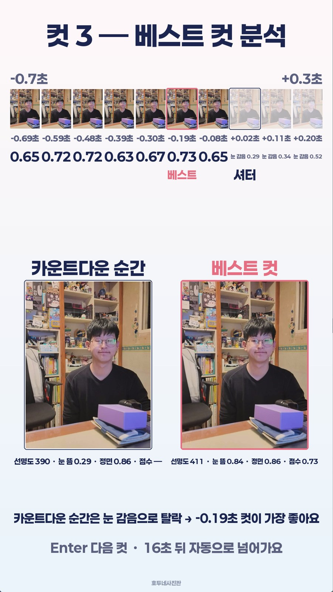
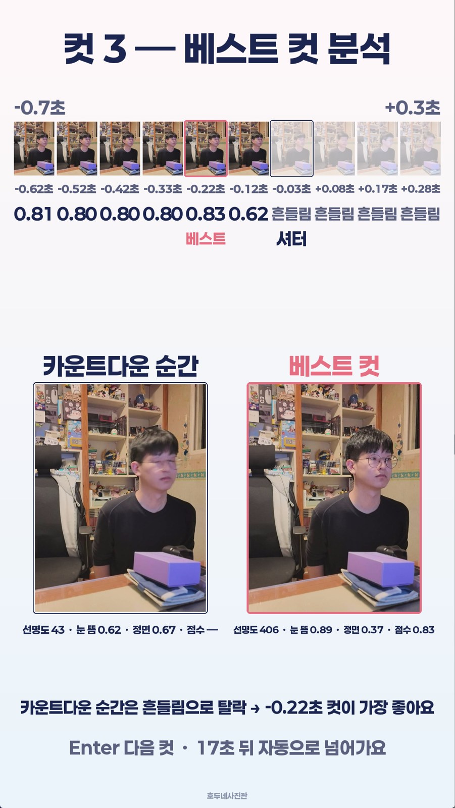
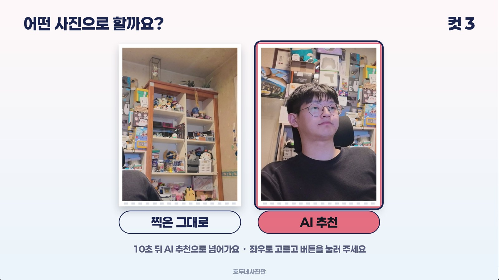
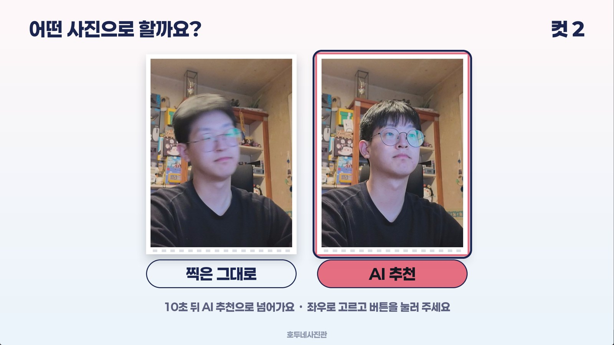

# 호두네사진관 — 지능형 촬영 및 스마트 구도 보정 (졸업작품)

호두네사진관은 행사 운영자가 이미 가진 PC · 카메라로 행사별 네컷 포토부스를 꾸리고 운영하게 해 주는 소프트웨어입니다.
이 저장소는 그중 **부스 앱**(Python · pygame-ce)과, 졸업작품으로 더한 두 기능을 담고 있습니다.

1. **AI 버스트 샷 · 베스트 컷 선택**: 셔터 앞 0.7초부터 뒤 0.3초까지 후보 약 10장을 모읍니다. 그중 눈을 감았거나 흔들린 컷을 빼고, 눈 뜸 · 선명도 · 얼굴 방향 점수가 가장 높은 한 장을 고릅니다.
2. **스마트 구도 보정 (센터 스테이지식)**: 얼굴 위치와 프레임 칸 비율 · 장식을 보고 칸마다 자를 영역을 계산합니다. 사람이 한쪽으로 몰리면 따라가고, 여럿이 퍼지면 넓게, 혼자 멀리 서면 더 확대합니다.

손님은 컷마다 **'찍은 그대로'** 와 **'AI 추천'** 중 하나를 고릅니다. 10초 동안 고르지 않으면 AI 추천으로 넘어갑니다. 이 선택 결과를 실사용 지표(AI 채택률)로 썼습니다.
새 모델을 학습하지는 않았습니다. 공개 모델(MediaPipe 얼굴 · 사람 검출)에 선택 규칙과 비용 함수를 설계해 붙이고, 실측으로 조정했습니다.

| 베스트 컷 분석 — 눈 감음 탈락 | 베스트 컷 분석 — 흔들림 탈락 |
|---|---|
|  |  |

| 한쪽으로 몰린 사람을 따라간 구도 | 흔들린 셔터 컷 대신 고른 선명한 컷 |
|---|---|
|  |  |

## 결과 요약

자세한 방법 · 표 · 한계는 결과 보고서(PDF, 메일 첨부)에 있습니다.

| 항목 | 기존 | 적용 후 |
|---|---|---|
| 모든 얼굴이 칸 안에 온전히 들어간 비율 (녹화 9개, 구도 보정) | 55.6% | **100%** |
| 사람 평가 구도 선호 (1~5, 조건 이름을 가린 시트) | 3.11 | **4.44** |
| 선택 컷의 눈 뜸 값 (가장 낮은 사람, 버스트) | 0.726 | **0.802** |
| 행사(2026-11-21) 사용자가 직접 고른 15컷 중 AI 추천 (본인 시험 촬영 제외) | — | **9컷 (60.0%)** |
| 행사 분석 시간 (시험 촬영 포함 37컷, 평균 / 최대, 상한 2초) | — | 0.86초 / 1.29초 |
| 부스 자동 시험 (이 저장소) | — | 1295 통과 · 2 건너뜀 |

## 실행 (Windows · Mac)

필요한 것:

- 웹캠
- Python 3.11 (mediapipe 0.10.21 휠이 3.13 이상에는 없습니다)
- 준비 단계에서 패키지를 받을 인터넷 연결

서버 · 관리자 웹 없이 부스 앱만 실행합니다. 얼굴 · 사람 검출 모델은 `booth/models/` 에 들어 있습니다.

```
cd booth

# 준비 (처음 한 번) — Windows
py -3.11 -m venv .venv
.venv\Scripts\python -m pip install -r requirements.txt

# 준비 (처음 한 번) — Mac
python3.11 -m venv .venv
.venv/bin/python -m pip install -r requirements.txt

# 실행 (Mac 은 .venv/bin/python)
.venv\Scripts\python main.py --dev-mode-all             # 권장: 컷마다 베스트 컷 분석 화면을 보여 줌
.venv\Scripts\python main.py --dev-mode-all --windowed  # 같은 것을 창 모드로
.venv\Scripts\python main.py --dev-mode                 # 분석 화면 없이 평소 부스처럼
```

| 인자 | 동작 |
|---|---|
| `--dev-mode-all` | 연결 코드 없이 기본 프레임으로 시작하고, 컷마다 **베스트 컷 분석 화면**을 보여 줍니다 |
| `--dev-mode` | 같은 부스를 평소처럼 사용합니다. 컷 고르기 화면은 나오고, 분석 화면은 나오지 않습니다 |
| `--windowed` | 창 모드 |
| `--list-cameras` | 연결된 카메라 번호 확인. 카메라가 잡히지 않으면 `booth/.env` 에 `CAMERA_INDEX=1` 처럼 적습니다 (`.env.example` 참고) |

- Mac 은 처음 실행할 때 터미널 · VS Code 에 카메라 권한을 허용해야 합니다.
- 버스트 · 구도 보정은 기본으로 켜져 있습니다. `booth/.env` 에 `BOOTH_BURST=0` · `BOOTH_SMART_CROP=0` 을 적으면 끄고, 둘 다 끄면 기존 부스와 똑같이 동작합니다.
- 완성 사진은 `booth/data-dev/collage/` 에만 저장되고, 밖으로 보내지 않습니다.

### 조작

| 키 | 동작 |
|---|---|
| `Enter` | 시작 · 선택 · 다음 |
| `←` `→` | 컷 고르기 화면에서 '찍은 그대로' / 'AI 추천' |
| `F2` | 지금 단계 건너뛰기 |
| `F5` | 처음 화면으로 |
| `ESC` | 패널 (개발자 모드는 PIN 없이 열림). 패널에서 `Q` 두 번이면 종료 |

### 분석 화면 읽는 법 (`--dev-mode-all`)

- **윗줄**: 셔터 -0.7초 ~ +0.3초 후보와 각 점수입니다. 흐린 칸은 탈락한 후보로, 사유(`흔들림` · `눈 감음` · `얼굴 수 부족`)가 함께 적힙니다.
- **가운데**: '카운트다운 순간'(기존 부스가 썼을 컷)과 '베스트 컷'을 나란히 보여 주고, 각각의 선명도 · 눈 뜸 · 정면도 · 점수를 적습니다.
- **아래**: 고른 이유가 한 줄로 나옵니다.

## 자동 시험

```
cd booth
.venv\Scripts\python -m pytest -q
```

부스 앱과 웹 부스가 같은 결과를 내는지 맞추는 기준 데이터(합성 · 필터 · 디자인 토큰)를 `shared/` 에서 읽습니다.
이 저장소에서는 **1295 통과 · 2 건너뜀**입니다. 건너뛰는 둘은 서버가 있어야 하는 끝까지 시험(`test_e2e.py`)과, 따로 켜야 도는 기준 스크린샷 생성(`test_design_baseline.py`)입니다.

## 폴더 구조 · 핵심 코드

```
booth/
  main.py                  실행 진입점 (--dev-mode · --dev-mode-all)
  walnut/
    burst.py               링 버퍼(FrameRing) · 셔터 전후 후보 수집 · 측정 기록
    analysis.py            분석 스레드 — 얼굴 검출(전체 + 좌우 반쪽) · 사람 찾기 · 사람별 얼굴 다시 찾기
    quality.py             후보 평가 · 베스트 컷 선택 (순수 함수)
    framing.py             구도 계산 · 프레임 장식 가림 지도 (순수 함수)
    scenes/choice.py       컷마다 '찍은 그대로' / 'AI 추천' 고르기 화면
    scenes/burst_show.py   베스트 컷 분석 화면 (--dev-mode-all)
    fieldlog.py            현장 기록 (숫자만, 사진 없음)
    compose.py · session.py · app.py   기존 촬영 흐름 · 합성에 연결
  tools/
    record_burst.py        평가용 시퀀스 녹화 (--consent 필요)
    eval_capture.py        4조건(baseline · 버스트 · 구도 · 둘 다) 비교 · 조건을 가린 평가 시트
    analyze_field_log.py   현장 기록 분석 (AI 채택률 · 분석 시간 · reason 분포)
  tests/                   자동 시험
  models/                  MediaPipe 얼굴(face_landmarker) · 사람(EfficientDet-Lite0) 모델
shared/                    시험 기준 데이터 · 디자인 토큰 · 기본 프레임 원본
```

판단 로직(`quality.py` · `framing.py`)은 카메라 · 화면 · 서버에 의존하지 않습니다. 그래서 녹화한 시퀀스로 같은 결과를 재현하고 시험할 수 있습니다.
부스 앱 전체의 기능 · 설정 설명은 [booth/README.md](booth/README.md)에 있습니다.

## 개인정보

- 운영 중에는 후보 프레임을 메모리에서만 쓰고 버립니다. 원본을 디스크에 저장하지 않습니다.
- 현장 기록에는 숫자(얼굴 수 · 선택 이유 · 시간 · 손님 선택)만 남기고 사진은 남기지 않습니다.
- 평가용 녹화는 본인과 동의한 지인만 찍었습니다. 표를 만든 뒤 지웠고, 이 저장소에도 넣지 않았습니다. README 의 스크린샷은 개발자 본인입니다.

## 중간보고 판

중간보고(버스트샷만 구현한 판) 때 보내드린 내용은 [`middle-report`](https://github.com/DJ-WALNUT/gradu-proj/tree/middle-report) 브랜치에 그대로 두었습니다.

## 이 저장소에 없는 것

호두네사진관의 서버(Flask) · 관리자 웹(React) · 웹 부스 · 리모컨 펌웨어는 별도 저장소에 있습니다. 졸업작품 범위인 부스 앱만 담았습니다.
서버가 없으므로 QR 공유 · 업로드 · 인쇄는 동작하지 않고, 공유 화면에는 "부스 PC 에 저장되었어요" 가 나옵니다.

## 라이선스 · 출처

- 글꼴: Paperlogy (SIL Open Font License, `booth/assets/fonts/OFL.txt`)
- 모델: MediaPipe Face Landmarker · EfficientDet-Lite0 (Google, Apache License 2.0)
